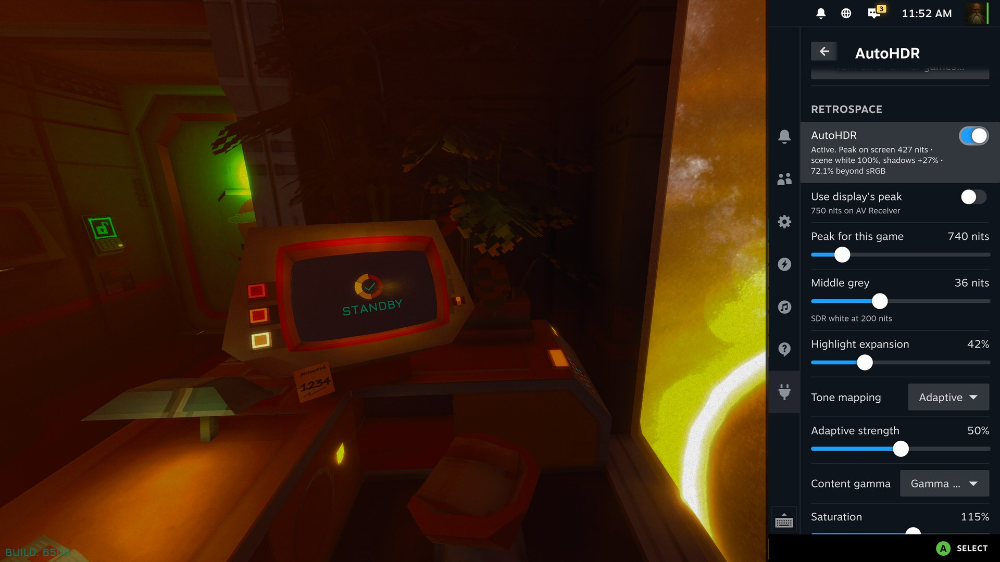
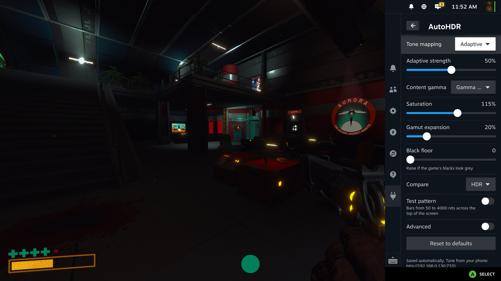
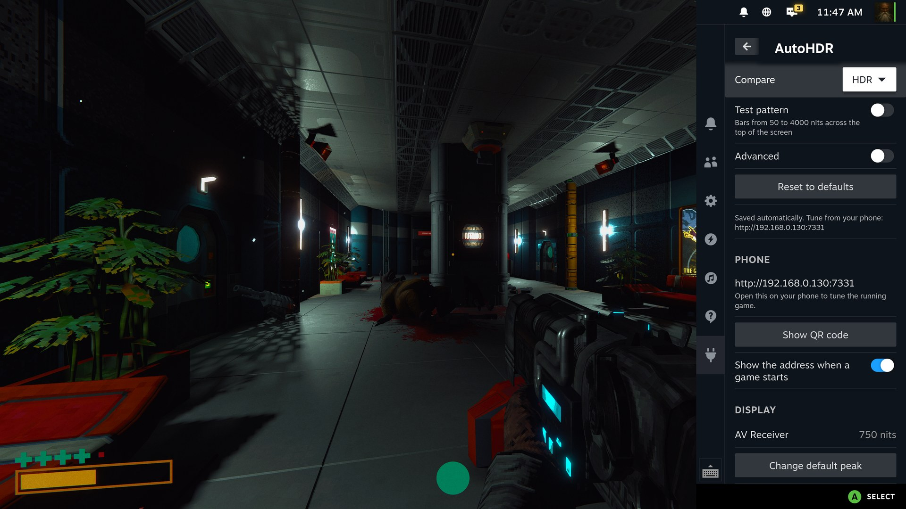
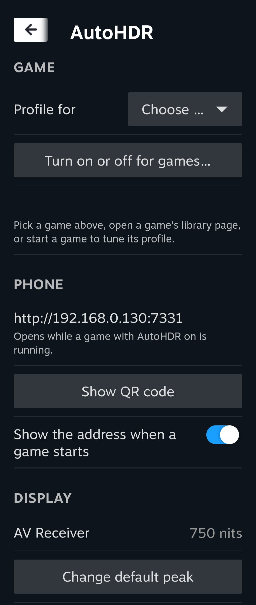
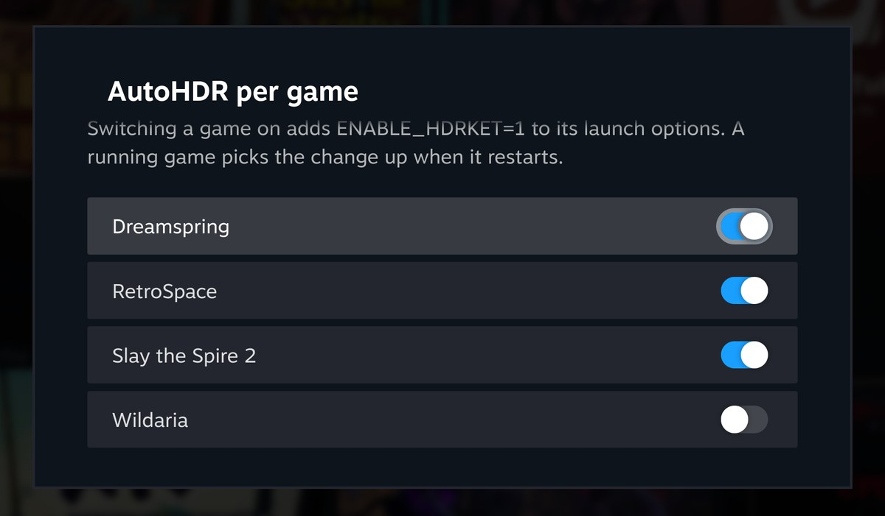
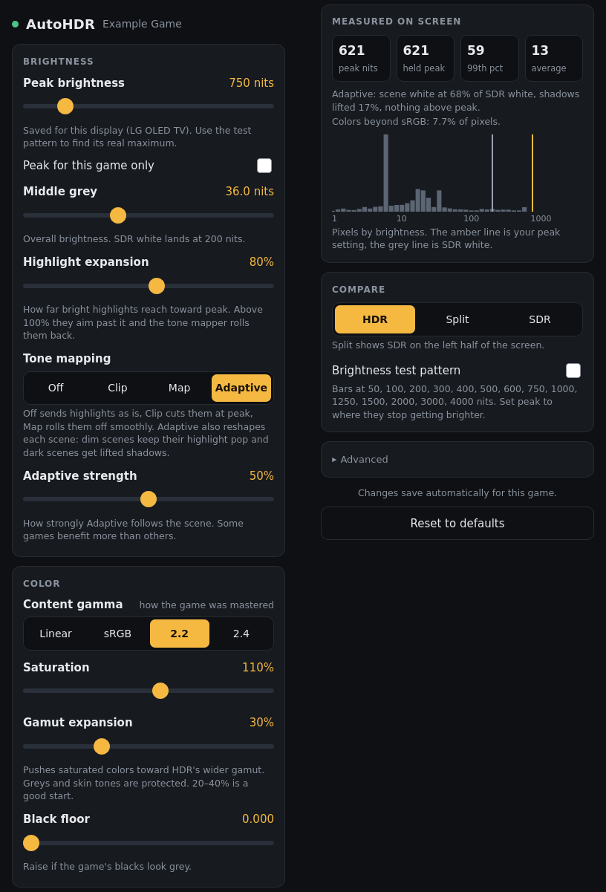

# AutoHDR for SteamOS (HDR-Ket)

Full, easy to use HDR mode for any SteamOS game. Inspired by AutoHDR, RTX HDR, and SpecialK HDR injection tools for windows. Supports tweaking  settings via Steam interface and phone interface in real time via a small included web server. Works with Steam Deck, native SteamOS, Bazzite, and really any Linux distro supporting native Steam Game mode (Big Picture)

AutoHDR is a Vulkan layer. It sits below DXVK, vkd3d-proton and native Vulkan,
so one code path covers D3D9 through D3D12 and native Linux games. No
injection into the game, no hooks, no extra frames queued: one compute pass per
frame turns the game's SDR image into HDR10.

A Decky Loader plugin adds the controls to the quick access menu.

## Features

- **Per-game on/off** from the Decky panel. It adds `ENABLE_HDRKET=1` to the
  game's launch options and leaves any other launcher settings you already have as-is.
- **Per-game profiles**, saved automatically: peak brightness, middle grey
  (overall brightness), highlight expansion, tone mapping, content gamma
  (Linear, sRGB, 2.2, 2.4), saturation, gamut expansion and black floor.
- **Tone mapping**: Off, Clip, Map (ITU-R BT.2390 roll-off) or **Adaptive**,
  which follows each scene: dim scenes keep their highlight pop, dark scenes
  get a gentle shadow lift.
- **Gamut expansion** toward BT.2020, with greys and skin tones protected.
- **Per-display peak brightness**, read from the display's EDID when it
  reports it, with optional per-game overrides. Can be set manually to override this value.
- **Tune from your phone**: every running game serves a tuning page on your
  network (port 7331). The plugin shows its address and a QR code. This is the easiest and fastest way to see changes in-game in real time.
- **Live measurements**: peak, average and a brightness histogram of what is
  actually on screen, plus a brightness test pattern for finding your
  display's real peak. This is great for tuning to make sure you're taking full advantage of your display's peak nits.
- **Split-screen compare** against the original SDR image, so you can make sure it's working and compare your settings vs original.

## Screenshots

The Decky panel in Game Mode, live in a game: the status line shows the peak on
screen, what adaptive tone mapping is doing and how much of the image uses
colors beyond sRGB. Every change applies on the next frame.



<p>
  
  
</p>

The panel without a game running, and the per-game on/off list:

<p>
  
  
</p>

The phone tuning page (left: brightness and color; right: live measurements,
compare and reset):



Screenshots can't show HDR: Steam saves them as SDR images, so the picture in
them is a tone-mapped stand-in for what an HDR display shows.

## Requirements

- An HDR display, with HDR turned on in Steam (Settings > Display) in Game
  Mode. On a Steam Deck that means the OLED model, or an external HDR display.
- A Mesa Vulkan driver (AMD or Intel). NVIDIA is untested.
- [Decky Loader](https://decky.xyz) for the plugin.

## Install

AutoHDR is not on the Decky store (see [why](#why-not-on-the-decky-store)).
Install it from this repository's releases with Decky's developer options:

1. In Game Mode, open Decky's settings (the gear in the Decky menu) and turn
   on **Developer mode**.
2. Open the new **Developer** section and use **Install Plugin from URL** with:

   ```
   https://github.com/OldRustyDusty/AutoHDR-SteamOS/releases/latest/download/autohdr-steamos-decky.zip
   ```

   Or download that zip and use **Install Plugin from ZIP File**.
3. Open the **AutoHDR** panel. The first time, it asks you to confirm your
   display's peak brightness.

The plugin installs the Vulkan layer into `~/.local` for your user. Nothing
changes for a game until you turn AutoHDR on for it.

## Using it

1. In the AutoHDR panel, pick a game under **Profile for** (or start it, or
   open its library page) and switch **AutoHDR** on. **Turn on or off for
   games…** does the same for several games at once.
2. Start the game. Every setting in the panel applies on the next frame while
   it runs, and saves automatically.
3. Use **Compare** to check against the original SDR image, and the **test
   pattern** to find your display's real peak: it is the last bar that still
   looks brighter than the one before it.
4. To tune from your phone, open the address in the panel's **Phone** section,
   or scan its QR code. The page is up while a game with AutoHDR runs.

**Reset to defaults** at the bottom of a game's settings starts it over.

### Settings

| Setting | What it does |
|---|---|
| Peak brightness | Your display's real maximum. Saved per display; a game can use its own. |
| Middle grey | Overall brightness: where SDR 18% grey lands. SDR white sits at grey / 0.18. |
| Highlight expansion | How far bright highlights reach toward peak. Above 100% they aim past peak and the tone mapper rolls them back. |
| Tone mapping | What happens above peak: Off, Clip, Map, or Adaptive (scene-following). |
| Adaptive strength | How strongly Adaptive follows the scene. |
| Content gamma | How the game was mastered. Gamma 2.2 suits most PC games. |
| Saturation | Color intensity. |
| Gamut expansion | Pushes saturated colors toward HDR's wider gamut. 20–40% is a good start. |
| Black floor | Crushes raised blacks. |

### Files

- `~/.config/hdrket/presets/steam-<appid>.conf`: each game's settings.
- `~/.config/hdrket/displays/<display>.conf`: each display's peak.
- `~/.local/state/hdrket/hdrket-<pid>.log`: logs from the layer.

## Troubleshooting

- **Nothing changes in a game**: check the log in `~/.local/state/hdrket/`.
  `passthrough: no usable HDR surface format` means the display path offers no
  HDR: turn HDR on in Steam's display settings.
- **Desktop mode**: games under XWayland get no HDR formats on KDE Plasma. Run
  them natively on Wayland (`PROTON_ENABLE_WAYLAND=1` for Proton, or Godot's
  `--display-driver wayland`) or inside `gamescope --hdr-enabled`.
- **Gamut expansion makes no visible difference**: some AV receivers report
  plain sRGB color in their EDID, and the display chain then clamps wide
  colors. The panel's *colors beyond sRGB* readout shows whether AutoHDR is
  producing them.
- **The phone page doesn't load**: the phone has to be on the same network,
  and the page only exists while a game with AutoHDR is running.

## Without Decky

The layer works on its own. Build and install it into `~/.local`:

```bash
meson setup build --prefix="$HOME/.local" --libdir=lib64
ninja -C build && meson install -C build
```

Then add `ENABLE_HDRKET=1 %command%` to a game's launch options. Settings can
also be set with `HDRKET_<SETTING>` environment variables, for example
`HDRKET_PEAK_NITS=800` or `HDRKET_TONEMAP=adaptive`.

## Building

Needs meson, ninja, a C++20 compiler, glslang, the Vulkan headers, Python 3,
Node.js and pnpm.

```bash
scripts/package-decky.sh      # layer + plugin -> out/autohdr-steamos-decky.zip
```

On Bazzite or SteamOS the scripts run the build inside a distrobox
(`hdrket-build`, or `hdrket-compat` with Ubuntu 22.04 for release builds that
run on older systems). Releases are built by GitHub Actions on Ubuntu 22.04.

## How it works

When a game creates an SDR swapchain, the layer creates the real one as HDR10
(PQ, BT.2020) and gives the game "shadow" images in the format it asked for.
At present time a single compute shader reads the game's frame, decodes it,
expands highlights, maps colors and tone maps to the display, and writes the
real swapchain image. The same pass measures the frame for the live readouts
and for adaptive tone mapping. More background is in `docs/design-notes.md`.

## Why not on the Decky store

The Decky plugin store asks submitters to confirm that generative AI was not
used to write most of the code. This project was developed with AI assistance,
so it is distributed here instead.

## Credits

AutoHDR builds on the work of these projects and people:

- **[PumboAutoHDR](https://github.com/Filoppi/PumboAutoHDR)** by Filippo
  Tarpini (MIT): the luminance-based, additive highlight expansion approach.
- **[vkBasalt](https://github.com/DadSchoorse/vkBasalt)** by Georg Lehmann and
  contributors (Zlib): the structure of a Vulkan post-processing layer.
- **[Decky Loader](https://github.com/SteamDeckHomebrew/decky-loader)**,
  **[decky-plugin-template](https://github.com/SteamDeckHomebrew/decky-plugin-template)**
  and **[@decky/api, @decky/ui](https://github.com/SteamDeckHomebrew/decky-frontend-lib)**
  by Steam Deck Homebrew (BSD-3-Clause, LGPL-2.1): the plugin platform, build
  setup and APIs.
- **[qrcode-generator](https://github.com/kazuhikoarase/qrcode-generator)** by
  Kazuhiko Arase (MIT): the phone QR code.
- **[react-icons](https://github.com/react-icons/react-icons)** (MIT) and
  **[Material Design Icons](https://github.com/google/material-design-icons)**
  by Google (Apache-2.0): the plugin icon.
- **ITU-R BT.2390, BT.2020/BT.2087, SMPTE ST 2084 and CTA-861**: the
  published standards behind the tone mapping, color conversion, PQ encoding
  and EDID parsing.

Studied for reference, no code used:
[gamescope](https://github.com/ValveSoftware/gamescope) (Valve),
[Mesa](https://gitlab.freedesktop.org/mesa/mesa)'s Vulkan WSI,
[VK_hdr_layer](https://github.com/Zamundaaa/VK_hdr_layer) (Victoria Brekenfeld),
[low_latency_layer](https://github.com/Korthos-Software/low_latency_layer) (Korthos Software),
Lilium's [DXVK HDR-mod](https://github.com/EndlesslyFlowering/dxvk) and
[ReShade HDR shaders](https://github.com/EndlesslyFlowering/ReShade_HDR_shaders) (EndlesslyFlowering),
and [Special K](https://github.com/SpecialKO/SpecialK) (Kaldaien), whose HDR
retrofit set the bar for how quick this should be to tune.

Developed with AI assistance from Claude Code.

Full license texts for third-party code are in `LICENSES/`, with a summary in
`THIRD_PARTY_NOTICES.md`.

## License

MIT. See `LICENSE`.
